<nav class="capsule-part-nav" aria-label="Time Capsule parts">
  <a href="#part-1" aria-current="location">Part 1</a>
  <a href="#part-2">Part 2</a>
  <a href="#part-3">Part 3</a>
</nav>

<section class="capsule-part" id="part-1" aria-labelledby="part-1-title">
  <header class="capsule-part-heading">
    
Part 1

    <h2 id="part-1-title">The Objects</h2>
  </header>

  
I’ve never thought of myself as a nostalgic person.

  
I’ve never made a conscious effort to hold on to things, because I feel like I’m always moving.

  
People, places, and things in my life keep changing, and I’ve never felt much need to hold on to something just to remember them by.

  
But there is one strange exception.

<section class="capsule-section" id="my-two-blankies" aria-labelledby="blankies-title">
  <header class="capsule-section-heading">
    
Objects 1–2

    <h2 id="blankies-title">My Two Blankies</h2>
  </header>

  

    <figure class="capsule-visual">
      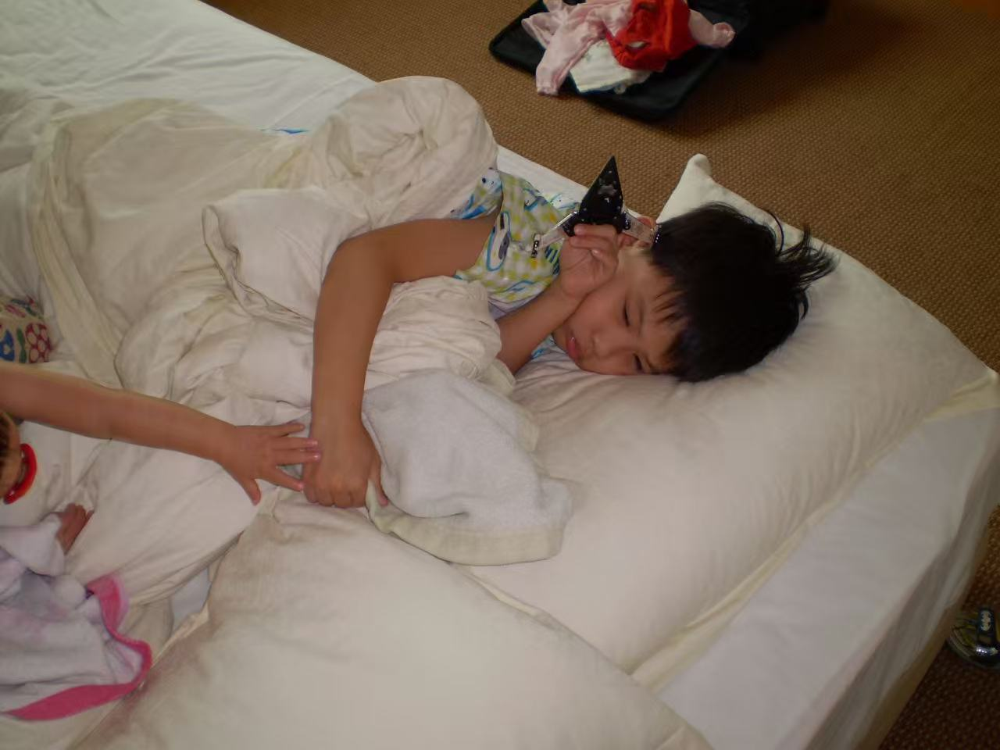
    </figure>
    

      
My mom tells me I was wrapped in this blanket when I was born. I wish there were more photos of us together from those early years, but this is one of the few my mom could find.

    

  

  

    

      <figure>
        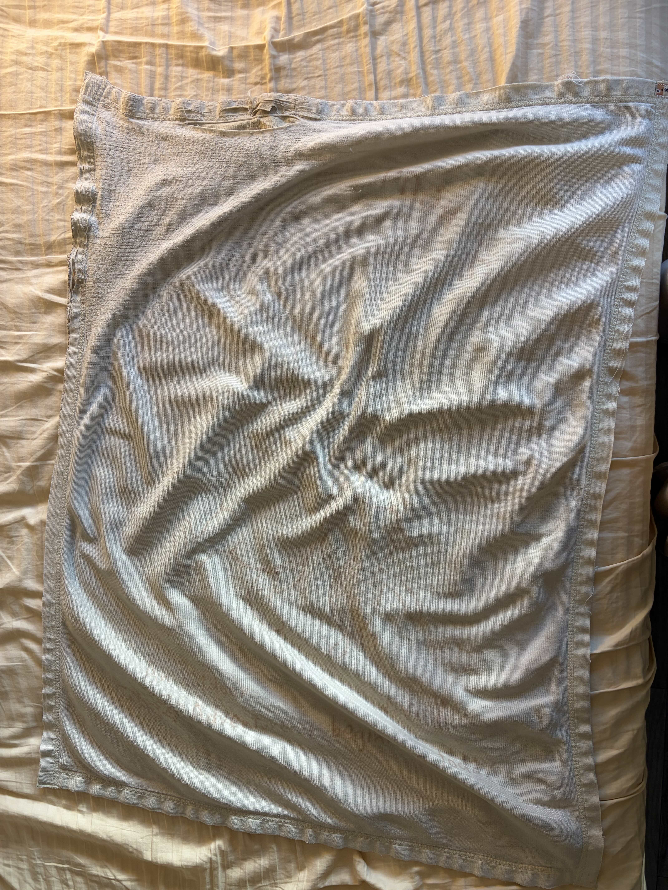
        <figcaption>Front</figcaption>
      </figure>
      <figure>
        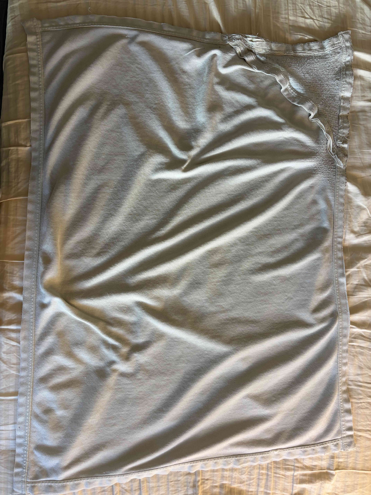
        <figcaption>Back</figcaption>
      </figure>
    

    

      
I’m lucky to still have it with me today. I sleep holding it almost every night. I’ve probably spent fewer than forty nights without it in my entire life.

    

  

  

    

      <figure>
        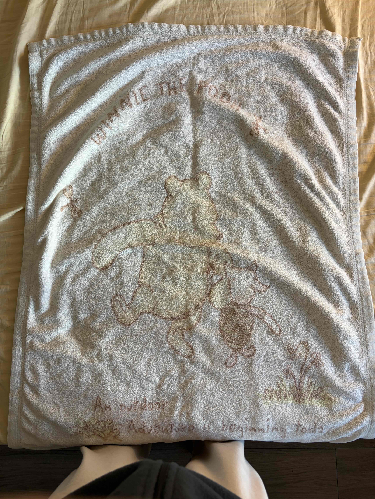
        <figcaption>Front</figcaption>
      </figure>
      <figure>
        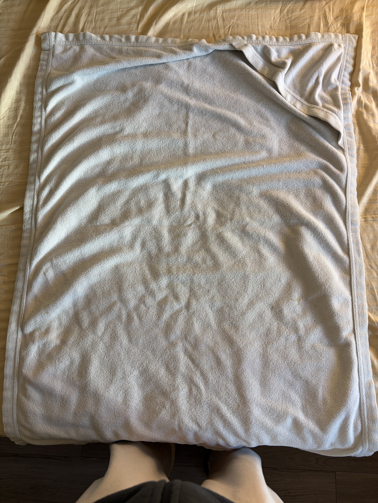
        <figcaption>Back</figcaption>
      </figure>
    

    

      
When I was three or four, my mom bought an identical blanket as a replacement. But I never felt the same way about it.

      
Looking at it now, it’s much closer to what my original blanky looked like when I was little. My original has changed so much over the years, while this one still looks familiar. Even so, it has never felt like my blanky.

    

  

  

    <h3>The places I reach for</h3>
    

    

      <figure>
        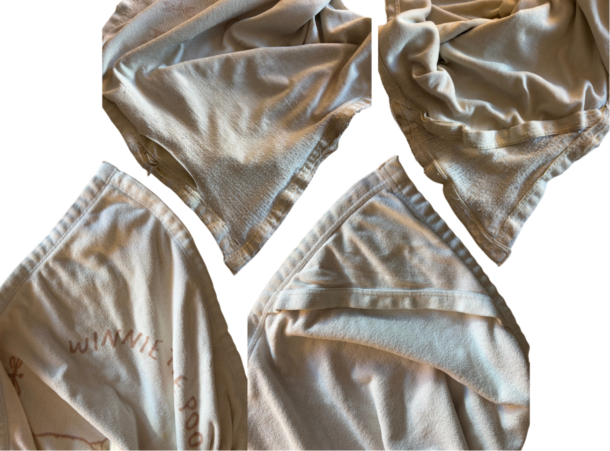
      </figure>
    

    

      
There are two places on my blanky that I especially like to touch. Whenever it’s beside me, I often find myself reaching for it and rubbing those spots without even thinking.

      
It feels like the habit is written into my code. Sometimes I wonder whether it distracts me, but the movement is so familiar that I barely notice I’m doing it.

      
When I first started rubbing these spots, my blanky probably still looked and felt much like the replacement shown below. After years of wear, the texture must have changed a lot. But the worn-out fabric is what feels familiar to me now. The replacement might be closer to how my blanky originally felt, yet it doesn’t give me the same feeling.

      
I wonder if I’ve been getting used to each small change without noticing.

    

  

    

  

    
My blanky keeps wearing out, and I know it won’t last forever. That thought has been with me for a long time. I can see it in the thinning fabric and fraying edges, but I still hold it every night and reach for it during the day.

    
This project has made me pay closer attention to something that has always felt like a given. Taking these photos and writing about it is a way of recording the details I usually take for granted: how it looks now, how I touch it, and how much of my everyday life includes it.

    
I don’t know whether documenting it will make losing it any easier. But maybe it’s a way to begin preparing for that, while it’s still here.

  

</section>

<section class="capsule-section" id="my-keyboard" aria-labelledby="keyboard-title">
  <header class="capsule-section-heading">
    
Object 3

    <h2 id="keyboard-title">My Keyboard</h2>
  </header>

  

    
The first piano I played was the one at home. My family wanted me to learn, but I didn’t enjoy it then. Playing felt like pressure.

    
Later, at boarding school, I saw an older student playing Beethoven and thought he looked really cool. It made me want to learn to play like that. I started teaching myself, and gradually began to enjoy playing.

    
I still miss the piano at home. I’m rarely there these days, and unfortunately I don’t have a photo of it to include here.

  

  

    

      <figure>
        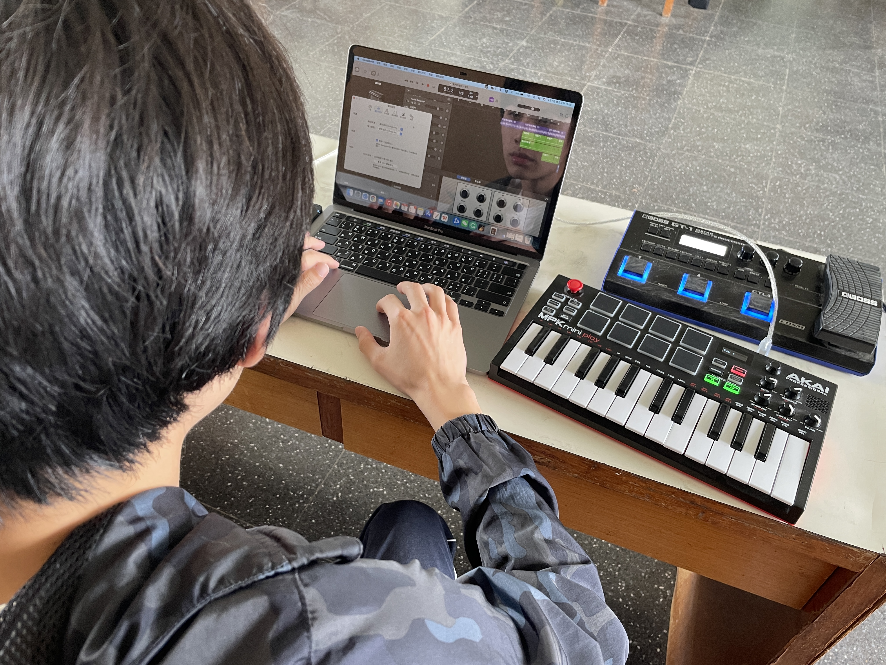
        <figcaption>My keyboard in high school</figcaption>
      </figure>
      <figure>
        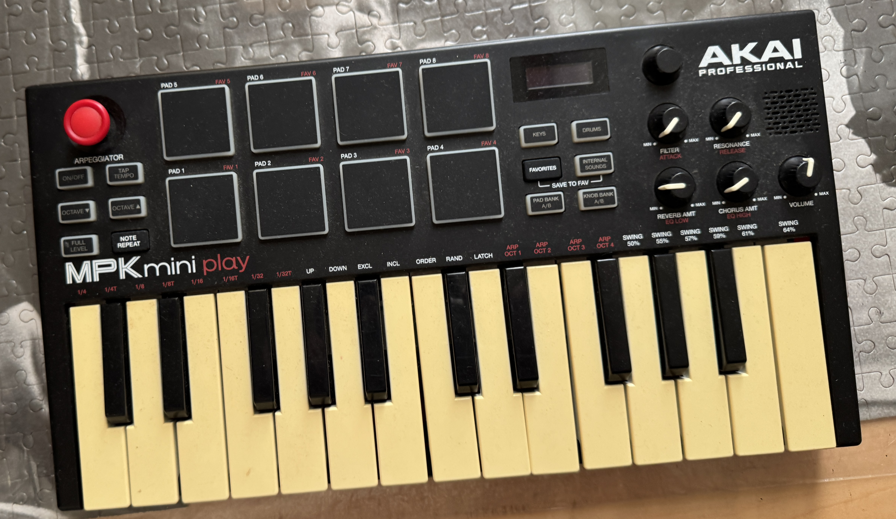
        <figcaption>The same keyboard today</figcaption>
      </figure>
    

    

      
This was the keyboard I used in high school, and this is what it looks like now.

    

  

  

    

      <figure>
        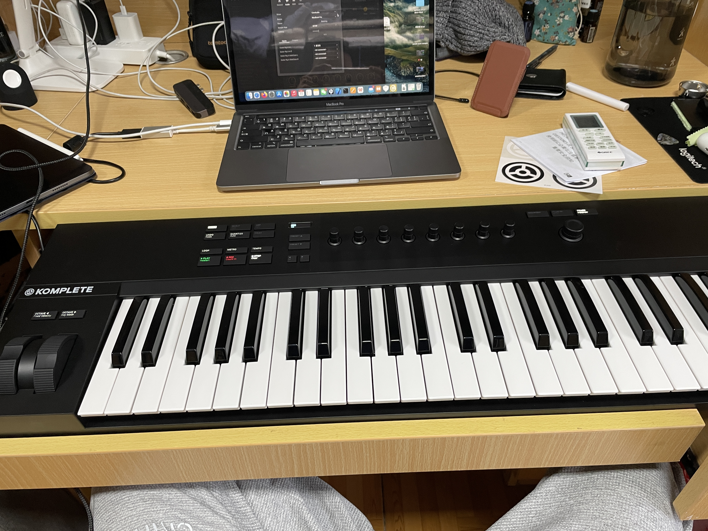
        <figcaption>A keyboard I used in college</figcaption>
      </figure>
      <figure>
        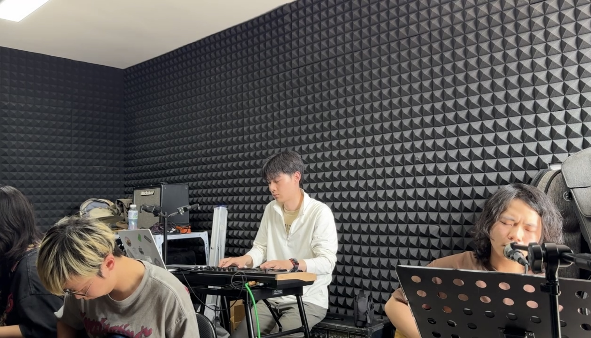
        <figcaption>My previous keyboard / Rehearsal video still</figcaption>
      </figure>
    

    

      
These are two keyboards I used during college. I couldn’t find many photos of the one I had before my current piano, so I took this still from a rehearsal video.

    

  

  

    <figure>
      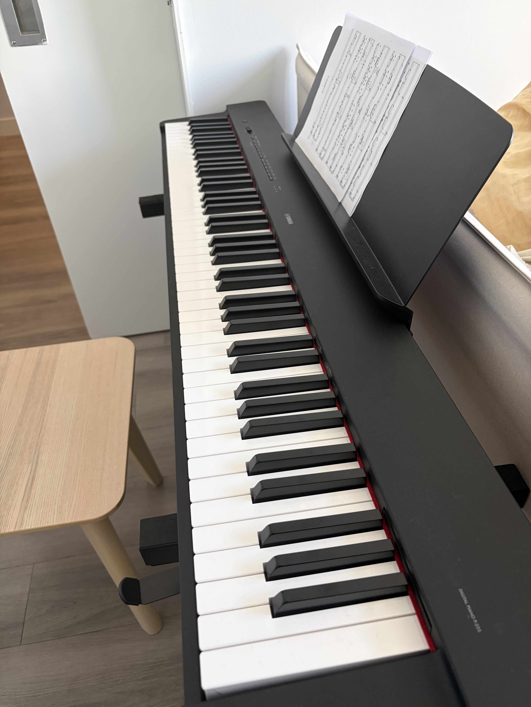
      <figcaption>My keyboard now</figcaption>
    </figure>
    

      
Unlike my blanky, a keyboard doesn’t have to be the same physical object for me to enjoy playing it. I’ve changed keyboards before, and I’ll probably change them again. That doesn’t mean I feel nothing for the individual instruments—I still miss the piano at home.

      
But having a keyboard where I live has become an important part of what makes being at home enjoyable for me. The instrument can change, while playing remains something I want in my everyday life.

    

  

</section>

</section>

<section class="capsule-part capsule-part--pending" id="part-2" aria-labelledby="part-2-title">
  <header class="capsule-part-heading">
    
Part 2 / In progress

    <h2 id="part-2-title">Design the Time Capsule</h2>
  </header>
  

    
I’ve often trusted intuition in design. In past projects, an idea would sometimes arrive suddenly, and I would know how I wanted to move forward. That hasn’t happened with this capsule yet. None of the ideas feels quite right. Maybe it’s because my blanky matters so much to me.

    
Lately, I’ve realized that my attachment to my blanky is also what’s wearing it out. It bothers me to see it getting thinner, especially knowing I can’t replace it. But I still use it every day, and I don’t want to stop.

  

  

    <h3>Choosing the inner container</h3>
    

      <figure>
        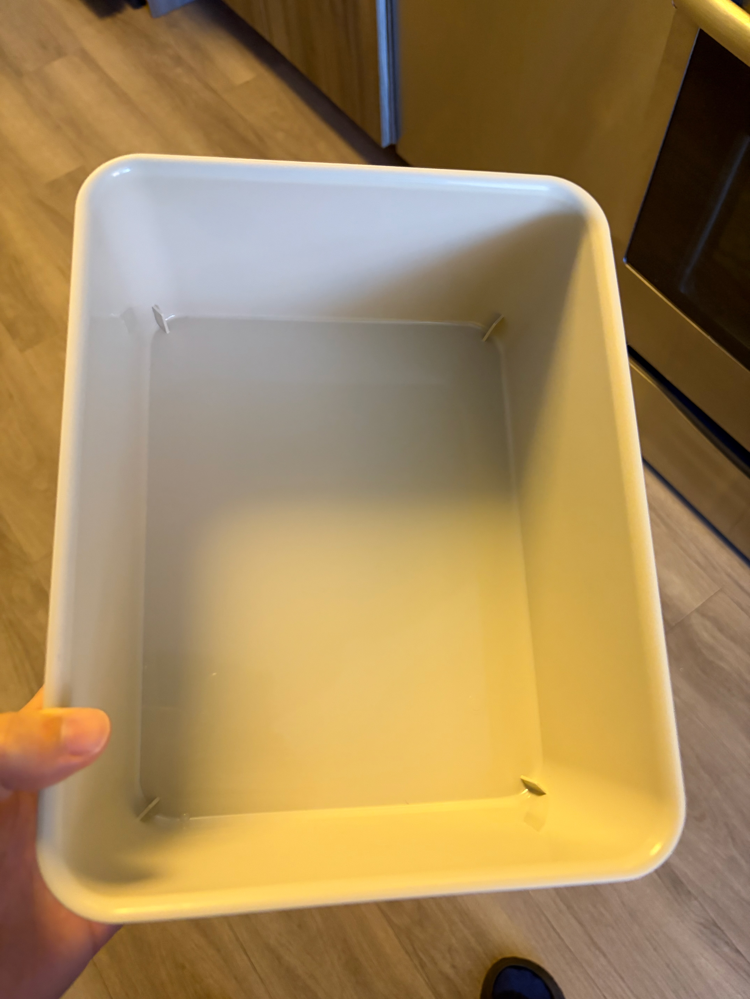
        <figcaption>The lidless storage box I started with.</figcaption>
      </figure>
      

        
I decided to start with something practical: a rigid inner container to support my blanky. I had a lidless storage box that was about the right size. I’m worried that taking the blanky directly out of an outer bag, without that support, could pull on the worn fabric and tear it. With the box, I can lift the whole container out instead.

        
I also chose it for its smooth surface. A fuzzy lining might seem softer, but I’m concerned that its fibers could catch in the blanky and cause more damage. A smooth container feels like a safer choice to me.

      

    

  

  

    <h3>Seeing the difference in thickness</h3>
    

      <figure>
        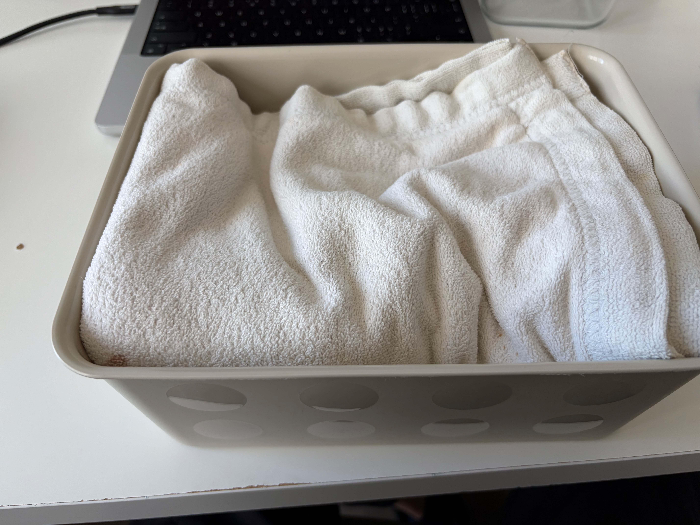
        <figcaption>The replacement blanket in the box.</figcaption>
      </figure>
      <figure>
        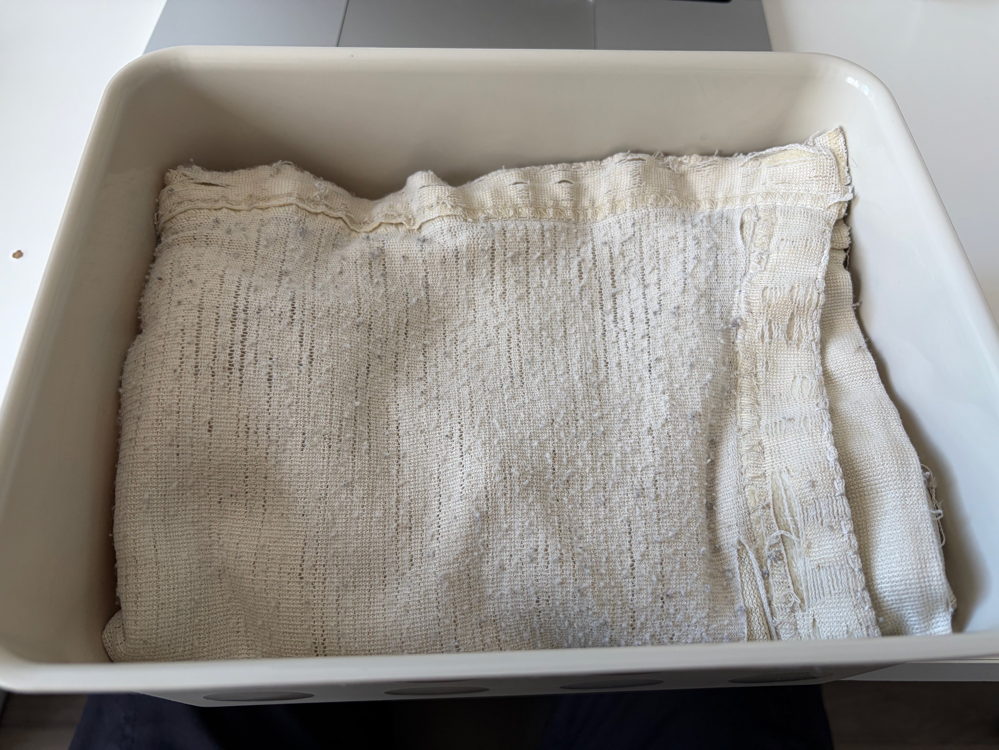
        <figcaption>My original blanky in the same box.</figcaption>
      </figure>
    

    

      
While trying the box, I folded each blanket and put it inside in turn. I could already feel the difference in thickness by touch, but seeing them in the same container made it much more obvious how thin my original blanky has become over the years.

    

  

  

    <h3>Trying the outer layer</h3>
    

      <figure>
        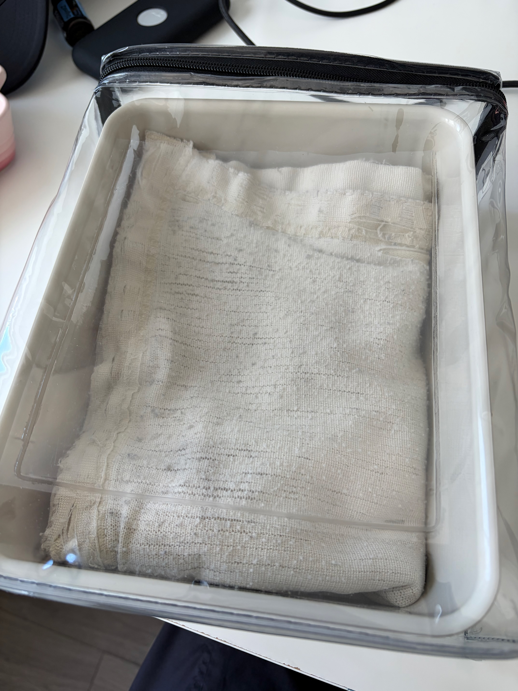
        <figcaption>Trying the storage box inside the bedsheet packaging.</figcaption>
      </figure>
      

        
I took the box with me to look for an outer layer. At a general store, I found a set of bedsheets whose packaging looked like a good fit for the box, so I bought it.

        
The clear zippered package fits around the box and lets me see the blanky inside. This is my first try at putting the two together.

        
Functionally, this meets my needs: the smooth, rigid inner container supports the blanky, and the transparent outer layer is easy to open and close.

        
Returning to that tension between attachment and wear, I want the design to acknowledge that feeling without making the choice seem more dramatic than it is.

        
I’ve considered a few approaches, but some feel too deliberate or too dramatic for what I actually feel. The feeling is real; I just don’t want to force it into a poetic gesture. I’m still figuring out how much the design needs to say.

      

    

  

</section>

<section class="capsule-part capsule-part--pending" id="part-3" aria-labelledby="part-3-title">
  <header class="capsule-part-heading">
    
Part 3 / Coming soon

    <h2 id="part-3-title">To Be Continued</h2>
  </header>
</section>

